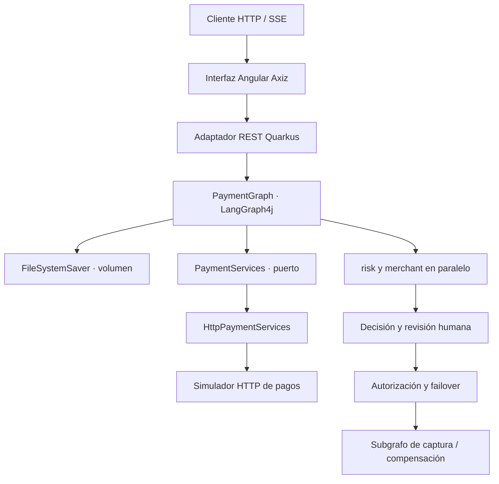

# LangGraph4j y Quarkus

Se implementa un flujo de integración de servicios mediante un grafo de estados ejecutable. LangGraph4j constituye el motor de orquestación: se definen nodos, transiciones, canales con reducers, ejecución paralela, ciclos acotados, subgrafos, checkpoints y pausas para intervención humana. Quarkus expone las operaciones HTTP, aplica validación y permite integrar el motor mediante CDI. No se necesita un LLM para este caso técnico: las decisiones de pagos se mantienen deterministas y verificables.

## Caso funcional

Se recibe un pago tokenizado de demostración, expresado en unidades monetarias menores. Se consulta riesgo y comercio en paralelo; se rechaza el riesgo alto, se solicita aprobación para riesgo medio y se autoriza el riesgo bajo. Ante indisponibilidad del adquirente principal se utiliza el secundario. Se captura una autorización y, si falla la captura, se ejecuta una anulación compensatoria. No se envían operaciones a redes de pago reales ni se almacenan números de tarjeta.

| Escenario | Resultado | Capacidad técnica observable |
|---|---|---|
| NORMAL | CAPTURED | Fan-out, unión y subgrafo |
| REVIEW | AWAITING_APPROVAL; después CAPTURED o REJECTED | Interrupción y reanudación con estado nuevo |
| DECLINE | REJECTED | Transición condicional |
| FAILOVER | CAPTURED, attempt=2, acquirer=secondary | Ciclo y selección de servicio alterno |
| COMPENSATE | COMPENSATED | Subgrafo y compensación |

## Tecnologías y alcance

Se fijan Java 25, Maven 3.9.16, Quarkus 3.40.1 y LangGraph4j 1.9.3. Se utiliza el BOM de Quarkus para resolver versiones compatibles de sus extensiones. Se emplean Java HttpClient para la integración HTTP, Bean Validation para contratos, Jackson para JSON y Spotless con Google Java Format 1.33.0 para formato. SmallRye Health y OpenAPI proporcionan diagnóstico y documentación de contratos.

Se usa `FileSystemSaver` de LangGraph4j sobre un volumen persistente. No se agregan PostgreSQL, Kafka ni otros motores porque no resultan necesarios para demostrar la orquestación. No se necesita Flyway: no existe un esquema relacional. La carga de ejemplos se realiza exclusivamente mediante la API y `datasets/seed.sh`.

| Capacidad de LangGraph4j | Implementación |
|---|---|
| StateGraph, CompiledGraph y START/END | Se valida y compila la topología en el arranque |
| Estado tipado | PaymentState encapsula el mapa persistible |
| Canales y reducers | events utiliza Channels.appender para combinar aportes paralelos |
| Executor configurable | Se asigna un executor de virtual threads a la rama paralela validate |
| Acciones asíncronas | node_async y edge_async; fan-out administrado por el motor |
| Paralelismo y unión | risk y merchant parten de validate y convergen en decision |
| Rutas condicionales | Riesgo, aprobación, autorización y captura |
| Ciclos acotados | Máximo de dos intentos y recursionLimit=30 |
| Subgrafos | settlement contiene capture y compensate |
| Interrupt/resume | interruptBefore(approval), GraphInput.resume con la decisión |
| Persistencia y aislamiento | FileSystemSaver y RunnableConfig.threadId por pago |
| Historia y consulta temporal | Historial y consulta de un checkpoint sin repetir efectos externos |
| Streaming | graph.stream alimenta el endpoint SSE por nodo |
| Recuperación de fallos | Se reanuda el siguiente nodo guardado mediante retry |
| Representación del grafo | Se genera Mermaid desde la definición real |

Se implementan las capacidades de orquestación pertinentes a la integración de servicios. Los adaptadores de modelos generativos, Studio y protocolos de interfaces de agentes no forman parte de este flujo. No se afirma que se implementa cada API opcional de la biblioteca.

## Arquitectura



Se aplica una estructura hexagonal con un dominio pequeño de pagos: contrato Payment, servicio de aplicación PaymentGraph, puerto PaymentServices y adaptadores HTTP de entrada y salida. Se evita convertir el grafo en un modelo de dominio financiero completo que no se necesita para la prueba.

## Estructura del proyecto

| Carpeta o archivo | Contenido |
|---|---|
| src/main/java/pe/axiz/payments/domain | Contrato del pago y restricciones |
| src/main/java/pe/axiz/payments/application | Estado, puerto y definición del grafo |
| src/main/java/pe/axiz/payments/adapter/in | API, autenticación, simulador y rutas de arranque |
| src/main/java/pe/axiz/payments/adapter/out | Integración HTTP con timeout |
| src/main/resources | Configuración de Quarkus |
| src/test | Pruebas de decisiones, persistencia e idempotencia |
| infrastructura | Compose, imagen base, imagen de aplicación y requests |
| datasets | Escenarios sintéticos y precarga mediante API |
| scripts | Ejecución en host y pruebas completas |
| frontend | Interfaz Angular adaptada desde la plantilla Axiz, cliente SSE y proxy Nginx |
| .env.example | Ejemplos y valores de las variables |
| mvnw | Lanzador de Maven con descarga verificada por SHA-512 |

## Código principal

En `PaymentGraph.init` se construye el subgrafo de liquidación y luego el grafo principal. Las acciones devuelven cambios parciales del estado; no se modifica directamente un mapa compartido. Se conservan las salidas de cada nodo en checkpoints. En `start` se vincula el identificador con la solicitud original: una repetición equivalente consulta el resultado y una repetición con otros datos devuelve HTTP 409. En `resume` se verifica que el siguiente nodo sea approval antes de aceptar la decisión.

`HttpPaymentServices` establece timeout de conexión y solicitud, propaga errores HTTP y conserva la interrupción del hilo. `SimulatorResource` permite observar respuestas deterministas sin credenciales de adquirentes. `ApiKeyFilter` protege pagos y operaciones del simulador mediante una clave local; health y OpenAPI permanecen consultables.

Se serializan las operaciones del motor en una sola instancia para proteger el saver y evitar dos avances simultáneos. Dentro de una ejecución, LangGraph4j conserva el paralelismo entre nodos. Se prioriza corrección sobre throughput en esta PoC.

## Preparación en Fedora WSL

Se requiere Node 24 para compilar la interfaz fuera de Docker. Se requiere Docker Engine con Compose v2.17 o superior y BuildKit, Java 25 para el método host, y curl, jq, tar y utilidades GNU. Se ejecutan todos los comandos desde la raíz del proyecto.

```bash
sudo dnf install -y curl jq tar gzip coreutils ripgrep java-25-openjdk-devel nodejs
export JAVA_HOME="$(dirname "$(dirname "$(readlink -f "$(command -v javac)")")")"
java -version
docker version
docker compose version
cp .env.example .env
chmod +x mvnw scripts/*.sh datasets/*.sh
```

Se instala o selecciona un JDK 25 y se configura JAVA_HOME si `java -version` muestra otra versión. Se utiliza `./mvnw` para obtener la versión fijada de Maven. Las variables y alternativas de configuración se encuentran exclusivamente en `.env.example`.

## Ejecución con infraestructura en Docker y aplicación en el host

Se levanta el simulador y se construye la imagen base reutilizable:

```bash
docker compose --env-file .env -f infrastructura/compose.yml up --build
```

En otra terminal desde la raíz se compila y ejecuta el orquestador:

```bash
bash scripts/run-host.sh
```

En otra terminal se precargan los cinco escenarios:

```bash
set -a; source .env; set +a
bash datasets/seed.sh
```

Se instala y ejecuta la interfaz desde otra terminal:

```bash
npm --prefix frontend ci
npm --prefix frontend start
```

Se abre [la interfaz](http://localhost:4200). El proxy de desarrollo dirige `/api` al puerto 8080; si se cambia el puerto del backend se ajusta `frontend/proxy.conf.json`.

Se muestran las rutas al arrancar el servicio y al finalizar la precarga. La ejecución en host conserva checkpoints en `.runtime/checkpoints`.

## Ejecución completa con Docker Compose

Se construyen la base y las aplicaciones, se levanta el simulador, se espera readiness y se precargan los pagos en un solo comando:

```bash
docker compose --env-file .env -f infrastructura/compose.yml --profile all up --build
```

Después de la primera construcción se reutilizan las imágenes:

```bash
docker compose --env-file .env -f infrastructura/compose.yml --profile all up --no-build --pull never
```

La imagen base de construcción conserva Maven y las dependencias; se utiliza una base de runtime separada con JRE 25, sin Maven ni caché de compilación. el Dockerfile de aplicación copia únicamente el código al stage de compilación y produce el paquete Quarkus. BuildKit utiliza la base mediante `additional_contexts`; no se intenta descargar `axiz-payment-base` desde un registro. Se reutilizan las capas mientras no cambie `pom.xml`. El servicio base termina con código 0, al igual que seed después de precargar: son tareas finitas.

La interfaz queda disponible en [http://localhost:4200](http://localhost:4200). Nginx conserva el streaming con buffering y caché desactivados, y reenvía `/api` al orquestador sin exponer la clave en configuración del servidor. Se utiliza Node 24 y Angular 22.2.1; la versión de TypeScript se ajusta al rango exigido por Angular.

Se publican puertos únicamente en loopback. El contenedor de aplicación se ejecuta con usuario 10001. Se conserva el volumen checkpoints al detener el proyecto. Los healthchecks redirigen la salida y no se habilita access-log, por lo que no se imprimen consultas periódicas de liveness.

```bash
docker compose --env-file .env -f infrastructura/compose.yml --profile all down
```

No se ejecutan ambos métodos simultáneamente sobre el mismo puerto. Para volver a cargar datos se puede ejecutar `bash datasets/seed.sh`; la operación resulta idempotente.

## Endpoints en orden de uso

Se envía `X-Api-Key` en todas las operaciones payments y simulator.

| Método y ruta | Función | Comportamiento técnico |
|---|---|---|
| GET /q/health/ready | Verificar arranque | Readiness de Quarkus; no verifica adquirentes externos |
| GET /payments/graph | Examinar flujo | Mermaid de CompiledGraph |
| POST /payments | Procesar pago | Valida entrada, ejecuta graph.stream y guarda checkpoints; HTTP 200 |
| POST /payments/stream | Procesar con seguimiento | SSE con eventos node y result durante la ejecución |
| GET /payments/{id} | Consultar resultado o pausa | Estado actual, siguiente nodo y checkpointId |
| GET /payments/{id}/history | Inspeccionar ejecución | Lista de snapshots del hilo |
| GET /payments/{id}/checkpoints/{checkpointId} | Consultar estado histórico | Lectura temporal sin invocar adquirentes |
| POST /payments/{id}/resume | Resolver revisión | APPROVED o REJECTED; reanuda el hilo pausado |
| POST /payments/{id}/retry | Recuperar fallo técnico | Reanuda el nodo pendiente; no se utiliza para pagos finalizados |
| POST /simulator/{operation} | Simular servicios | risk, merchant, authorize, capture o void; puerto 8081 |
| GET /q/health, /q/health/live | Diagnóstico | Salud y liveness |
| GET /q/openapi, /q/swagger-ui | Consultar contratos | OpenAPI y explorador HTTP |

Un identificador inexistente devuelve 404; una clave incorrecta, 401; datos inválidos, 400; una transición incompatible o solicitud distinta con el mismo identificador, 409. Un fallo de transporte se propaga como 500 y se conserva el último checkpoint confirmado.

## Interfaz y experiencia de seguimiento

Se conserva la identidad visual Axiz de la plantilla adjunta, con navegación lateral, paneles oscuros y acentos turquesa. Se adapta el contenido al procesamiento de pagos. Se elige un escenario, se revisa el importe y se inicia un pago con seguimiento en vivo. El importe se expresa en unidades menores; 15000 representa 150.00 PEN.

Se utiliza `fetch` con lectura incremental del body para SSE de tipo POST y cabecera de acceso. No se usa EventSource porque no permite este contrato de POST con cabecera personalizada. Se procesan eventos completos incluso cuando el JSON o UTF-8 queda dividido entre paquetes. Se distinguen conexión activa, resultado final y cierre inesperado. Al perderse el seguimiento se consulta el último checkpoint; no se envía automáticamente un pago nuevo.

Se muestra una línea de eventos, el estado del pago, el adquirente y sus intentos. Los pagos REVIEW presentan acciones para aprobar y continuar o rechazar. Se bloquean envíos duplicados durante una operación y se puede consultar un pago por identificador después de recargar la página. Solo se almacenan identificadores recientes en localStorage; la clave permanece en memoria durante la sesión.

Se puede detener el seguimiento local. Esta acción cierra la lectura SSE; no garantiza la cancelación del pago en el servidor. Se mantiene disponible la consulta del estado persistido para evitar que la interfaz muestre una cancelación financiera inexistente. El historial permite seleccionar checkpoints sin repetir efectos externos. Se incorporan etiquetas accesibles, estados de foco, mensajes de error, diseño adaptable y navegación por teclado.

## Pruebas por curl

Se cargan las variables locales antes de ejecutar los ejemplos:

```bash
set -a; source .env; set +a
export BASE_URL="http://localhost:${HTTP_PORT}"
curl -fsS "$BASE_URL/q/health/ready" | jq
curl -fsS "$BASE_URL/payments/graph" -H "X-Api-Key: $API_KEY"
```

### Pago aprobado e idempotencia

Se ejecutan riesgo y comercio en paralelo, autorización y captura. Se espera `state.status=CAPTURED`, `state.attempt=1` y `nextNode=__END__`. El objeto steps contiene las salidas reales del motor y events registra acciones; los nombres internos de nodos paralelos pueden incluir prefijos de la biblioteca.

```bash
curl -fsS "$BASE_URL/payments" -H "X-Api-Key: $API_KEY" -H 'Content-Type: application/json' --data @infrastructura/requests/normal.json | jq
curl -fsS "$BASE_URL/payments" -H "X-Api-Key: $API_KEY" -H 'Content-Type: application/json' --data @infrastructura/requests/normal.json | jq
```

La segunda solicitud devuelve el checkpoint existente sin ejecutar de nuevo el pago. Una respuesta representativa contiene:

```json
{"nextNode":"__END__","checkpointId":"<generado>","state":{"id":"curl-normal","amountMinor":15000,"currency":"PEN","scenario":"NORMAL","status":"CAPTURED","attempt":1,"acquirer":"primary","authorizationId":"auth-curl-normal"}}
```

Se incluyen también los campos de riesgo, comercio y events; se omiten en este ejemplo abreviado.

### Revisión y reanudación

Se detiene el grafo antes de approval. Se espera `nextNode=approval` y `state.status=AWAITING_APPROVAL`; todavía no se autoriza el pago. Se puede reiniciar el orquestador antes de reanudar para comprobar persistencia.

```bash
curl -fsS "$BASE_URL/payments" -H "X-Api-Key: $API_KEY" -H 'Content-Type: application/json' --data @infrastructura/requests/review.json | jq
curl -fsS "$BASE_URL/payments/curl-review/history" -H "X-Api-Key: $API_KEY" | jq
curl -fsS "$BASE_URL/payments/curl-review/resume" -H "X-Api-Key: $API_KEY" -H 'Content-Type: application/json' --data @infrastructura/requests/approve.json | jq
```

Con `{"approval":"APPROVED"}` se espera CAPTURED. Con `{"approval":"REJECTED"}` en un pago REVIEW nuevo se espera REJECTED. Una segunda reanudación del mismo pago devuelve 409.

### Riesgo alto, failover y compensación

Se prueba cada rama mediante su request dedicado. Se espera REJECTED para decline, CAPTURED con attempt=2 y acquirer=secondary para failover, y COMPENSATED para compensate.

```bash
for scenario in decline failover compensate; do
  curl -fsS "$BASE_URL/payments" -H "X-Api-Key: $API_KEY" -H 'Content-Type: application/json' --data @"infrastructura/requests/$scenario.json" | jq '{state,nextNode}'
done
```

### Streaming y checkpoint histórico

Se reciben eventos SSE por nodo mientras se ejecuta un pago nuevo. Se usa un identificador nuevo para observar una ejecución completa.

```bash
curl -N -fsS "$BASE_URL/payments/stream" -H "X-Api-Key: $API_KEY" -H 'Content-Type: application/json' --data '{"id":"curl-stream","amountMinor":15000,"currency":"PEN","scenario":"NORMAL"}'
checkpoint_id=$(curl -fsS "$BASE_URL/payments/curl-normal/history" -H "X-Api-Key: $API_KEY" | jq -r '.[0].checkpointId')
curl -fsS "$BASE_URL/payments/curl-normal/checkpoints/$checkpoint_id" -H "X-Api-Key: $API_KEY" | jq
```

Se espera `event: node` con `{"node":"...","state":{...}}` y al final `event: result`. La consulta temporal devuelve node, nextNode y state; no se vuelve a capturar ni anular un pago.

### Fallo de integración y recuperación

Se detiene el simulador desde otra terminal. Se envía un pago con identificador nuevo; se espera HTTP 500 al intentar integrar risk o merchant. Se consulta history para observar el checkpoint anterior al fallo. Se levanta de nuevo el simulador y se reanuda el nodo pendiente:

```bash
curl -i "$BASE_URL/payments" -H "X-Api-Key: $API_KEY" -H 'Content-Type: application/json' --data '{"id":"curl-recovery","amountMinor":100,"currency":"PEN","scenario":"NORMAL"}'
curl -fsS "$BASE_URL/payments/curl-recovery/history" -H "X-Api-Key: $API_KEY" | jq
curl -fsS "$BASE_URL/payments/curl-recovery/retry" -H "X-Api-Key: $API_KEY" -H 'Content-Type: application/json' --data '{}' | jq
```

No se reintenta una integración indefinidamente. La disponibilidad del adquirente principal se modela como un resultado de negocio transitorio y se resuelve con el ciclo de failover; un error de transporte requiere recuperar el servicio antes de retry.

## Suite completa y formato

Con el orquestador y simulador disponibles se ejecuta el conjunto de pruebas con un solo comando:

```bash
bash scripts/test-all.sh
```

Se ejecutan pruebas del grafo y del parser SSE (fragmentación UTF-8, heartbeats y datos inválidos), comprobación de formato Java y frontend, compilación Angular y pruebas HTTP de escenarios e idempotencia. Se crean identificadores nuevos para no depender de datos previos. Para ejecutar únicamente pruebas y compilación sin servicios disponibles:

```bash
./mvnw -B -ntp verify
```

Para aplicar el formato antes de modificar el proyecto:

```bash
./mvnw -B -ntp spotless:apply
```

## Límites operativos y adaptación

Se trata de una PoC avanzada de integración con un motor de grafos, no de una conexión certificada con adquirentes. FileSystemSaver permite persistir y reanudar en una instancia; no proporciona coordinación distribuida ni atomicidad de pagos entre sistemas. Los checkpoints se escriben mediante la implementación de la biblioteca y no constituyen una garantía de exactly-once ante una interrupción abrupta durante un efecto externo. Para conectar adquirentes reales se requiere una clave idempotente por operación, consulta del resultado incierto y conciliación antes de repetir una captura.

El simulador no produce efectos financieros y sus resultados son deterministas. Los subgrafos se mantienen sin saver independiente porque sus operaciones se resuelven en una misma invocación; la persistencia del padre conserva su estado confirmado. Un despliegue de varias réplicas requiere un saver transaccional y bloqueo por hilo. La clave compartida de demostración se sustituye por autenticación y autorización adecuadas, incluida segregación de aprobación humana, antes de exponer el servicio fuera de loopback.

## Fuentes oficiales

- [LangGraph4j 1.9: core](https://langgraph4j.github.io/langgraph4j/1.9/core/core-library/)
- [LangGraph4j: releases](https://github.com/langgraph4j/langgraph4j/releases)
- [Quarkus: releases](https://quarkus.io/releases/)
- [Quarkus: soporte Java 25](https://quarkus.io/blog/quarkus-3-31-released/)
- [Maven Central: versiones publicadas](https://repo.maven.apache.org/maven2/)

## Validación realizada

Se verificó la compilación y empaquetado del backend con Java 25.0.4.1, Maven 3.9.16 y Quarkus 3.40.1. Pasaron siete pruebas del grafo y la comprobación de formato Spotless. Se verificó el build de producción Angular 22.2.1 con Node 24, la comprobación Prettier y tres pruebas del parser SSE.

Se ejecutaron los dos procesos Quarkus y se comprobaron por HTTP la precarga, los cinco escenarios, idempotencia, historial, eventos SSE reales y respuestas negativas 401, 400 y 409. Se validó el archivo Compose mediante `docker compose config`. No se ejecutó el build ni el arranque de los contenedores porque el entorno de validación no dispone de Docker Engine. No se completó la comprobación visual automatizada en navegador por una limitación del navegador disponible en ese entorno.
